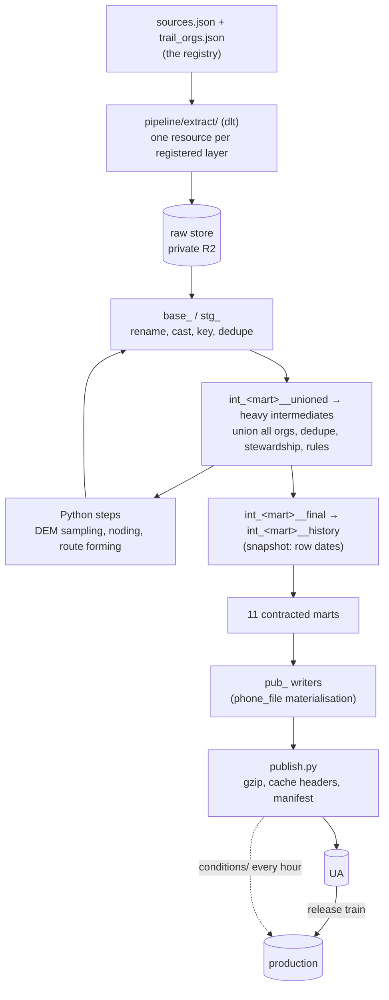

# The data pipeline: dlt, dbt and the files a phone reads

This is how OurHike's data gets from about 150 trail organizations and a dozen national services onto a hiker's phone, as it runs today. It was built under **#1793 — Rebuild the data platform as dlt → dbt: seven contracted marts, a monthly refresh, published docs, and lighter phone downloads**, in **PR #1805 — dlt → dbt re-platform as one go/no-go change**. How it got here, the run-by-run measurements and the polls that settled each choice are in that pull request and in git history, not here.

In one line: **dlt** reads every upstream into a private raw store, **dbt** turns the raw tables into eleven contracted marts, `pub_` writer models turn the marts into phone files, and `publish.py` uploads them.

## Contents

- [What runs](#what-runs): the monthly lane, the hourly lane, the notices job, and what each publishes
- [How data flows](#how-data-flows): extract and load, the dbt layers, publish (reverse ETL)
- [The eleven marts](#the-eleven-marts): what each holds, its contract and versions, row dates
- [The data checks](#the-data-checks): layout, the run check, freshness, test thresholds, data quality
- [Who may publish](#who-may-publish): licences, held sources, what may be fetched
- [Rules we follow](#rules-we-follow): closures and notices, water, licences, data and geometry, testing, releases
- [How to add an org](#how-to-add-an-org)
- [What nobody has checked yet](#what-nobody-has-checked-yet)

Related documents: `pipeline/INCREMENTAL.md` (the storage tiers and per-source clocks this builds on), `pipeline/R2_LAYOUT.md` (public bucket keys), `pipeline/DATA_RELEASES.md` and `RELEASING.md` (how a build reaches production), `features/ORG_NOTICES.md` (what a notice shows a hiker), and the two skills, `.claude/skills/dlt/SKILL.md` and `.claude/skills/dbt/SKILL.md`, for working on each layer.

## What runs

| Job | When | What it does | Publishes to |
|---|---|---|---|
| `refresh-reference.yml` | 05:15 UTC on the 3rd of each month, or by hand | The **monthly lane's extract**: every monthly resource into the raw store, then a pin (a frozen copy of exactly what was read, named by its `raw_run`). Ends by dispatching `build-reference.yml` with that `raw_run`. Takes no inputs. | nothing |
| `build-reference.yml` | dispatched, with a `raw_run` | The **monthly lane's build**: `build_marts.py --lane monthly` over the pin, the UA publish, a confirm job, parity against today's exporters, then the retention step (`prune_raw_store.py`). | UA only |
| `publish-conditions.yml` | `:40` every hour | The **hourly lane**, one leg per environment (production and UA): extract the hourly tables (ATC's and NYNJTC's notices, OPRHP's closures, NWS alerts, OurHike's own moderated closures and reports, the drought feed), add the notices job's latest served copy, `build_marts.py --lane hourly`, publish, then the source freshness step. Its `checks` job starts `check-conditions.yml` once both legs have published. | production and UA, `conditions/` keys |
| `extract-notices.yml` | every 4 hours, at `:22` | The **notices job**: every other club's and agency's closures and warnings, with up to an hour to read, then a served copy the hourly build reads. | nothing a phone reads |
| `check-conditions.yml` | started by `publish-conditions.yml` | Elementary's checks over the hour's handed-off warehouse, `conditions/data_quality.json`, and the hourly parity comparison. Nothing a hiker reads waits for it. | `conditions/data_quality.json` |
| `publish-weather.yml` | `:55` every hour | The NBM forecast, which stays outside dbt. | UA only |
| `purge-person-fields.yml` | dispatch only | Deletes every stored object that still holds a person field. Its `delete` input defaults to `false`, which only lists. | nothing |
| `pipeline-tests.yml`, `dbt` job | every pull request | Builds the whole project on fixtures, or only what changed when `state_base.py` can prove the rest is unchanged. | nothing |

GitHub fires these crons late and irregularly: **#1346 — Every cron in this repository fires about five times a day, whatever it declares — including the conditions bake**. The hourly lane's measured median gap was 4.0 hours over 40 runs to 2026-09-25, which is why closures are judged against a day, not an hour.

**A schedule refreshes UA; only the release train changes what a hiker downloads.** The one exception is `conditions/`, which both legs write straight to their environment every hour: a reopened trail must stop being served, which an immutable release folder cannot do.

### Every node carries its cadence

Every dlt resource, dbt source and exposure carries `meta.cadence`: `hourly`, `daily`, `weekly` or `monthly`. The home is Python, a per-type default in `pipeline/extract/_contract.py` with a written reason on any override; the generated YAML is written from it. A node is built only by the lane matching its fastest upstream. Closures, warnings, NWS alerts and OurHike's Postgres rows are hourly; NYNJTC's alert taxonomy terms are daily; nothing is weekly; the rest is monthly. `build_marts.py`'s `LANE_EXCLUDES` and `LANE_PARENTS` select each lane (not a dbt selector, because `--selector` cannot be combined with `-s` or `--exclude`).

### Why a scheduled run cannot reach production

- `refresh-reference.yml` takes no input, and `build-reference.yml` takes no environment; both publish with the literal `ua`.
- `publish.py` scopes every key by `OURHIKE_DATA_ENV`, so a UA run cannot write production's keys.
- Phones read the release their environment's `channels.json`, in the bucket, names. `build-reference.yml`'s last job moves UA's, and only UA's, once every check in that run has passed. Production's moves only by `promote-data.yml`, a dispatch the `production` environment's reviewer approves.
- Production data is never dispatched from pull-request follow-up. A promotion copies the release folder UA was tested on, byte for byte, so what is promoted is what was checked.

### Rebuilding from a pin

A fix to a build whose extract was good is tried on that extract's pin, with no new extract. Each `refresh-reference.yml` run's summary prints the command:

```sh
gh workflow run build-reference.yml --ref main -f raw_run=<raw_run>
```

A change to an extractor, or a new upstream answer, needs a new pin: dispatch `refresh-reference.yml`.

### Where data lives

| Tier | Holds | Where |
|---|---|---|
| Raw store | every resource's rows as Parquet (zstd), each lane its own dlt pipeline, plus `_extract_runs`, the run log | private bucket `our-hike-raw`, under `raw/` |
| Step cache | pins (`steps/raw_inputs/<raw_run>/`), stored warehouses (`steps/dbt_warehouse/<env>/<raw_run>/`), expensive Python steps' outputs as GeoParquet | same bucket, under `steps/`, write-once |
| Row history | each mart's snapshot, saved between runs | the history store; the monthly store keeps its newest 3 saves, the hourly stores 24 |
| Warehouse | every dbt model | one `warehouse.duckdb` per build, rebuilt each run |
| Phone files | what phones download | the public bucket `our-hike`, served at `data.ourhike.org`; only `publish.py` writes it |
| Docs | dbt docs and `/data/quality/` | `docs.ourhike.org/data/`, built in CI, never committed |

One read-and-write key (`R2_RAW_BUCKET`, `R2_RAW_ACCESS_KEY_ID`, `R2_RAW_SECRET_ACCESS_KEY`) covers the private bucket. Each monthly build's retention step deletes what is no longer needed: it keeps each environment's served `raw_run` (pin and warehouse), the newest pin before UA's, every newer pin, the as-landed files a kept pin was copied from, and 3 row-history saves. `prune_raw_store.py`'s docstring has every rule. Names read back from a store (table names, paths) pass `lib/store_names.py` before they become SQL or a path.

## How data flows



### Extract and load (dlt)

**Every source is reloaded whole, behind a skip-unchanged check.** An unchanged upstream (same ETag, edit date or count) is left out of the run; a changed one is read in full and written with `replace`. A lifted closure leaves by its absence. Cursors, change capture and tombstones are not used, because a cursor never sees a delete.

**A failed load never empties a safety table.** dlt's default replace strategy empties a table before loading it, so a load that fails part-way would leave "no closures" and pass every check. So a build reads only committed loads (the run log's `loaded` rows), a table whose load did not commit keeps its last committed copy, and the after-run check confirms the rows on disk equal the rows normalized. A source that is refused, or still fails after its retries, keeps its last committed table and the run is marked partial.

**One extraction per upstream dataset.** Each dataset is read once, under its steward. A copy another org republishes is a `SAME_AS` note and is never read. An org's share of a steward's layer (a club's stretch of the USFS trail layer) is not a copy either: it is an assignment in `int_<mart>__stewardship`, one row per (feature, org, basis, evidence). So each feature reaches its mart once, with its stewards attached.

**Raw tables are `raw_<folder>__<key>`**, where the folder is the org's `trail_orgs.json` slug with `-` written `_`, and the key is the layer's `sources.json` key. A table name is never derived from a display name.

**The extract layer is moving to one loader.** Today `pipeline/extract/` has one folder per org holding a resource file per published type, plus `_shared/` for national services (NWS, USGS, OSM, Census, OurHike's own database) and one `not_available.toml` holding every org × type that publishes nothing loadable, each a dated note. The replacement, being built now, is a single loader that builds every org's resources from its `sources.json` rows: the row names the reader kind (ArcGIS layer, Socrata, page, PDF, feed, workbook and so on), the fields, the key and the provenance that used to sit in each file's docstring, so every org follows the same code path. `not_available.toml` keeps the notes. `.claude/skills/dlt/SKILL.md` describes the shape as built.

**dlt is configured against four measured hazards** (`pipeline/.dlt/config.toml`, held by tests):

- Geometry carries a `json` hint. On dlt's defaults the A.T. centerline's 3,025 features became 2,072,165 rows in 4 tables and still reported `LOADED` (measured 2026-09-09).
- An empty `replace` truncates, so an unchanged upstream is skipped, never run empty, and a zero is accepted only with proof (below).
- Telemetry is off, because these jobs hold write keys.
- Retries are ours, one retrying session per source, and dlt is pinned and hash-checked like every pipeline dependency (`requirements-extract.txt` installs with `--require-hashes`).

**No raster lands as data.** DEM pixels are read in place (range reads of USGS 3DEP tiles) and only their samples are cached; NBM grids leave only their derived squares; topo and basemap rasters belong to the background map. DuckDB has no raster type, and its `raster` extension was about 50 times slower for the same samples (1,000,000 points, 200 s against 4.1 s, measured 2026-09-24).

**Person fields never load.** They are left out inside the resource, so no copy exists to leak: a denylist (`PERSON_FIELDS`), each ArcGIS layer's own editor-tracking fields, and any column whose name reads as a person's (`PERSON_SHAPED`: names, `contact`, `phone`, `email`, a role, a word ending in `by`) unless its name ends in an organization's mark (…Org, …Agency, …Unit, …Dept) or its row clears it in `not_person_fields`. A free-text column that carries personal data is left out whole, even when it also holds a useful note. The purge for a slip is `purge-person-fields.yml`; the dlt skill has the steps.

### Transform (dbt)

dbt 2.0.6, the `dbt` distribution, one version everywhere: CI, `scripts/test.sh`, the lanes and the docs build. Its install and packages are hash-pinned. dbt refuses Python models on DuckDB, so anything that must stay Python runs as a step outside dbt (below).

**The generated models are written at build time, never committed.** `python generate_dbt.py` runs `make_dbt_staging.py` and `generate_notice_models.py`; every place that parses the project runs it first. A registry edit is the whole change; the SQL it produces is not in the diff, so run the generator and read what it writes.

| Layer | Name | Does |
|---|---|---|
| base | `base_<steward>__<layer>`, in `staging/<steward>/base/` | One `source()`. Renames, casts, lowercases every column, sets CRS84 on geometry, builds the row's key and dedupes on it. No filter, no join. |
| staging | `stg_<org>__<mart>` | Conforms to the mart's columns and carries the key. Nothing else. |
| union | `int_<mart>__unioned` | `union all by name` of every org's staging model, no filter. By name, never by position: a positional union once put every DEC lean-to in Antarctica on a green run. |
| heavy | `int_<mart>__<verb>` | Publication filter, dedupe, corridor, water distance, mile axis, graph, notice rules. |
| stewardship | `int_<mart>__stewardship` | Which orgs steward each feature, by ATC's club-section polygons, the org's trail list, or a name or id match. Assigns, never copies. |
| final, history | `int_<mart>__final`, `int_<mart>__history` | The mart's SQL as a view, then a dbt snapshot of it (row dates, below). |
| mart | one of the eleven names | Contracted table, `access: public`, read by exposures. |
| publish | `pub_<file>` | Writes one phone file (below). |

Seeds hold every rule that is data rather than code: `notice_words.csv` (the closing-word vocabulary), `notice_source_fields.csv` (which column of a source holds status, category, title, season), `licence_restriction_phrases.csv` and `publishable_licence_bases.csv` (publication), `layer_rules.csv` (a layer's own filters, such as a historic alignment that may not route), `club_poi_types.csv` (an allowlist of POI codes per layer), and `dbt_project_evaluator_exceptions.csv`, each exception with a comment.

### One key per table

Every model has one key column, unique and not null, tested at error. A key of several columns is built with `dbt_utils.generate_surrogate_key`. The key's inputs are the registry key, then the upstream's own id where it is unique (GlobalID, else the layer's object id), else the smallest set of current values measured unique. Never a row's position in the file. Two closures models that cut areas keep their key test at warn, a recorded exception. A publisher's reload can renumber an object id, so anything that joins across releases (the POI identity ledger, graph cells) checks the release too.

### Python steps, outside dbt

Rules go to SQL first, then to a DuckDB extension, then to Python, each step down with a written reason. Ten steps stay Python, in `build_marts.py`'s `STEPS` order: `step_long_path_guide`, `step_site_water`, `step_osm_water`, `step_osm_water_grade`, `step_poi_photos`, `step_node_lines`, `step_dem_sampling`, `step_weather_squares`, `step_closure_trail_lines` and `step_form_route`. Each reads named intermediates and writes a `derived` table that dbt reads back as a source (`stg_derived__*`). The reasons: raster reads (above), noding that must match shapely's bit for bit, route search with no graph extension for this DuckDB, and a restored file that may be missing without stopping the hour. Two models (`int_places__resolved`, `int_trail_network__cuts`) carry `tags=['builds_alone']` so each gets DuckDB's whole memory.

### Publish (reverse ETL)

Publishing is the reverse-ETL step: it loads marts into the downstream system, which here is files on R2.

- **Every phone file is a dbt exposure.** Its `meta` names the R2 keys, format, coordinate decimals, size budget where one is set, and cadence. The exposures sit beside their writers in `pipeline/dbt/models/publish/_publish__*.yml`.
- **A `pub_` model writes each file** with the project's `phone_file` materialisation (GeoJSON at 6 decimals, packed JSON, or PMTiles through GDAL), into `pipeline/data/processed/`. Graph and area cells are cut afterwards in Python (`cut_trail_graph.py`, `cut_cells.py`).
- **Writers run last**, as a final selection once every other model and test has passed, so a failing test never leaves a file behind.
- **`publish.py` uploads.** dbt never writes the public bucket: a DuckDB `COPY` to S3 stored objects with no `Content-Encoding` and no `Cache-Control` (measured 2026-10-01).
- **A writer that fails keeps its last copy**, and the rest publish. A notice source whose rows fail a safety test is held in `int_closures__gate` with its reason and carries its last good rows; every other file publishes and the run turns red.
- Two writer pitfalls: never call `ST_ReducePrecision` on a line that pairs with per-vertex arrays (it dropped 3 of 249,046 vertices); round each coordinate instead. And coalesce `features` to `[]`, because an empty closures file is a normal state.

### Versions and channels

A release id used to mean two things at once, a file's shape and the build a phone reads. They are split.

- **The shape is a dbt model version.** Each contracted mart that feeds a phone file declares `versions:`. v1 is the shape installed apps read, at today's keys. An added column is not a new version: phones ignore fields they do not know, and an absent field means unknown. A removed, renamed or retyped column is, and v1 keeps being written beside v2 until its `deprecation_date`. v2 files go under a `v2/` segment. `check_contract_versions.py` fails a pull request that breaks a version's shape without adding one.
- **The build is a pointer.** Each environment's `channels.json`, in the bucket beside its `latest.json`, names per schema version the release its phones read; no copy is committed. `pipeline/channels.py` writes it, refuses a release whose manifest is not in that environment's tree, and appends each move to `channels_history.json`. A first run reads it before rendering and takes its release (`client/src/lib/dataChannel.ts`); offline, or with a pointer it cannot use within 4 seconds, it reads the compiled `DATA_RELEASE`, the known-good floor. Later launches read it and follow it from the next launch; offline a phone uses the release it last read. A recorded release whose own manifest answers exactly 404 is forgotten, so a bucket move cannot strand a phone. Any other failure keeps it.
- **Promotion and rollback.** UA's pointer moves when a monthly build (`build-reference.yml`) passes every check it runs. `promote-data.yml` copies a UA release into production, verifies it, and moves production's pointer; rollback is the same workflow with an older release. `DATA_RELEASE` moves only with the schema version. The deploy guards check that the floor and the pointed-to release each resolve at their own base.
- The update row (`chrome/TrailDataUpdate.tsx`) offers the pointed-to build: "Newer trail data", or "Changed trail data" when the pointer moved back.

### What a phone downloads

| Kind | Files | When |
|---|---|---|
| Drawn by the map | `nearby_trails.pmtiles` | read by range, tile by tile. At z5 to z8 the tiles carry only `source`, `name`, `blaze_color` and `trail_status`, so no tile goes over GDAL's size cap and gets snapped to a coarse grid; every trail is kept. |
| Held whole, offline | `trails.geojson`, `poi_<type>.geojson` ×8, water and shelters from every org, `trail_miles.json`, `elevation_profile.json` | with the release |
| Graph and area cells | `trail_graph_cell_*.json` and their index | per 1° cell; a phone never merges cells from two releases |
| Hourly, at launch | `conditions/closures.json`, `atc_updates.json`, `nynjtc_alerts.json`, `weather_alerts.json`, `reports.json`, `hazard_areas.json`, `trail_closures.json` | each conditions refresh |
| Hourly, on a plan | `conditions/notices.json`, `conditions/notice_states.json` | only once a hike is planned; a phone with no plan downloads neither |
| Monthly, small | `places.json`, `suggested_hikes.json`, `challenges.json`, `spurs.json`, `club_sections.json`, `stewards.json`, `registry.json`, `trail_graph*.json`, `podcasts/episodes.json` | with the release |

Area outlines in `notices.json` are grown outward 100 m and then simplified at 100 m, so a route that touched the original area still touches it. That took one soak hour's file from 24,966,662 to 9,706,068 bytes (measured 2026-10-05). Four hourly files come from no mart and are still written by today's exporters: `conditions/drought.json`, `notes.json`, `disputes.json` and `work_projects.json`.

## The eleven marts

Every mart carries `club` (the folder that extracted the row), `source_key` (tested against `sources`) and `_loaded_at`, plus `_first_seen_at` and `_changed_at` (below). Every mart except `sources` keeps only rows whose source may publish. The YAML beside each mart (`models/marts/<mart>/_<mart>__models.yml`) describes every column.

| Mart | One row per | Key | Lane | Versions | Feeds |
|---|---|---|---|---|---|
| `trail_lines` | published line: centerline, side trail, spur, network | `trail_line_id` | monthly | v1, v2 | `trails.geojson`, `trail_miles.json`, the network files and tiles, `spurs.json`, `club_sections.json` |
| `points_of_interest` | published POI | `poi_id`, held stable by the identity ledger | monthly | v1, v2 | `poi_<type>.geojson`, `nearby_poi.geojson`, `retired_poi.geojson` |
| `elevation` | 25 m sample on a profiled line | `line_sample_key` | monthly | v1, v2 | `elevation_profile.json`, the graph's elevation and profile files |
| `trail_network` | graph edge | `edge_id` | monthly | v1 | `trail_graph.json` and its cells |
| `closures` | notice, area or report that blocks the trail | `closure_id` | hourly | v1 | `conditions/closures.json`, `notices.json`, `trail_closures.json` |
| `warnings` | NWS alert, notice that does not block or is unclassified, serious report, hazard area | `warning_id` | hourly | v1 | `conditions/weather_alerts.json`, `reports.json`, `notices.json`, `hazard_areas.json` |
| `podcasts` | episode | `spotify_id` | monthly | v1 | `podcasts/episodes.json` |
| `challenges` | challenge | `challenge_id` | monthly | v1 | `challenges.json` |
| `places` | named park, town, trailhead, parking or trail | `place_id` | monthly | v1 | `places.json` |
| `suggested_hikes` | hike | `hike_id` | monthly | v1 | `suggested_hikes.json`, `highlights.json` |
| `sources` | registered layer or feed | `source_key` | monthly | v1 | `stewards.json`, `registry.json` |

**Contracts are enforced on every mart**: column names, types, `not null`, `primary_key` and `check` constraints. A contract violation fails the build before the old table is replaced. Geometry is `geometry('OGC:CRS84')`, set in every base model. No `foreign_key` constraints, because DuckDB will not drop a referenced table on rebuild; relationships tests do that job.

**Row dates.** `_first_seen_at` is the first build whose snapshot held the row's key; `_changed_at` is the build whose snapshot first held its current content. Each mart has one dbt snapshot, `int_<mart>__history`, under the mart's key, comparing a hash of every contracted column (so an editor's name or an edit time nothing publishes never moves a date). Snapshots are saved between runs in the history store and restored before the next build; the clock is UTC. If the hourly lane cannot restore its history, the closures and warnings marts still build, with both dates null (unknown, never new), nothing is saved, and the run goes red: a hiker still gets the closure. The monthly lane stops instead. `macros/row_history.sql` holds every piece; `tests/test_dbt_row_dates.py` and `test_dbt_row_dates_builds.py` enforce it.

**Safety fields**, each held by a constraint or test:

- `trail_lines.geom` is the 1 m navigation line; `length_m` and every published mile are geodesic on WGS84, measured at full resolution. `trail_status` is `open` or `closed`; a layer with no status ships open, which is a default, not a finding.
- `points_of_interest.capacity` is null or at least 1. Absent means unknown, never zero.
- `points_of_interest.water_distance_ft` is above 0, and is null exactly when `water_distance_source` is null, so a distance never ships without its provenance. `confidence` is `high` or `low`.
- `points_of_interest.mile` is set only for a point on the A.T.
- `elevation.elevation_ft` is null where the DEM has no coverage, never 0. `distance_mi` increases strictly within a line.
- `trail_network`: climb gain and loss are both null or both set; no closed trail is an edge.
- `closures.obstructs_trail` is true on every row. `warnings.obstructs_trail` is false, or null when unclassified (`review_state = 'not_reviewed'`). Every notice lands in exactly one of the two.
- `sources.may_publish` is never null.

## The data checks

| Check | When | What it catches |
|---|---|---|
| Layout (`tests/test_extract_layout.py`) | every pull request | a registered layer nobody reads, or read twice; one upstream URL or item id under two keys; a note with the wrong shape; a staging model for a type that is only a note. It checks a note's shape, never its age, so the calendar cannot fail an unrelated pull request. |
| Run check (`extract/_run.py`) | after every dlt run | a resource that did not run, an upstream that refused, emptied, halved or came back short of its own count, and a load that did not commit. |
| Note ageing | monthly, not upstream of any publish | a note past `confirmed + recheck_after_days` (default 180, `@unvalidated`): an org that started publishing after somebody looked, or a `SAME_AS` copy that drifted from its original. |
| Source freshness | every lane, after the build | a source OurHike has not read or confirmed unchanged within its limits. |
| dbt tests and contracts | every build | the rules in each model's YAML, unit tests and singular tests. |
| Elementary's checks | after the writers; hourly in `check-conditions.yml` | volume, schema and value anomalies, per org and source. |
| Parity | monthly build; every hourly run | a dbt-written file that differs from today's exporter on the same inputs without a written reason. |

**The run check** refuses a package before load when a resource is missing or empty without proof, and records `unverified` after the load when rows on disk differ from rows normalized:

- **A zero needs the upstream's own count, read in the same run.** A reader's count of what it parsed is not the upstream's, because a page whose layout moved parses to nothing exactly as an empty page does. Each reader kind declares `zero_proof` (`extract/_contract.py`); `tests/test_extract_zero_proofs.py` pins every kind.
- **Short fails, long passes**, where the upstream gives a count: a layer edited between the count and the pages can move either way.
- **No collapse**: fewer than half the last loaded count fails (the floor `fetch_opentrail.py` already used, `@unvalidated` per type). A closures layer that counts its upstream has no floor, because every closure being lifted looks exactly like that.

**Freshness measures OurHike's last successful read**, never the publisher's own dates: `macros/last_read_or_confirmed_at.sql` reads the run log's newest `loaded` or `skipped` row for the source. Hourly and notice sources warn and error by their job's hours (NWS errors after 2 hours unread, other hourly and notice sources after 24); monthly sources warn at 35 days and error at 62 (`@unvalidated`). A notice source that never ships errors after 7 days. Freshness never holds back a publish; it turns the run red. Measuring the publisher's own edit dates instead had produced 97 warnings on one hourly page for clubs that simply had not posted (measured 2026-10-15).

**Every test has two thresholds**, `warn_if` and `error_if`, and every source `warn_after` and `error_after`. One switch, `OURHIKE_DATA_ENV`, decides what an error does:

- In **dev and CI**, an error fails the job.
- In **production and UA**, an error is recorded, shown on the run summary and the data-quality page, and the build goes on, holding only what the failing test reaches. The run turns red after publishing.
- **Safety gates stay errors everywhere**: tests on the `pub_` writers, on the six marts a hiker's safety reads (`closures`, `warnings`, `points_of_interest`, `elevation`, `trail_lines`, `trail_network`), and on the closures gate. A failure there holds the affected files at their last good copy.

**Elementary's checks** (volume, schema, dimension and column anomalies) run in one pass after the writers and never change a build's exit. An anomaly warns where Elementary flags a point and errors past 6 deviations and 50% from the usual value (`@unvalidated`); a removed or retyped column is an error, an added one a warning. No failing row ever leaves the warehouse (`test_sample_row_count: 0`), because the hourly lane carries hikers' reports. A pull request runs only the checks on what it changed and everything downstream; a change dbt's state comparison cannot see (a macro, a var, a package pin) runs every check.

**The data-quality page** at `/data/quality/` is OurHike's own page, built from Elementary's tables: every failure listed, warnings folded one line per kind, and a chart of each mart's row counts drawn against the band from the builds before each point. Each lane writes its own `data_quality.json` sidecar. `edr`, Elementary's own CLI, is not used: it brings a second dbt and sends usage events.

**Hourly parity** compares the six `conditions/*` files with today's exporters on the same hour's upstream answers, recorded once (`extract/_answers.py`) so no upstream is asked twice. An unexplained difference turns that hour's checks run red after everything has published; a store with no comparison bundle for 2.5 hours does too.

## Who may publish

Every layer is loaded; publication is gated downstream, once, in `int_sources__publication`, which sets `may_publish` for each layer. These are the rules it applies, all the maintainer's rulings, none a grant from any agency:

- **A layer registered in `sources.json` publishes on its own row**: `reaches_hikers` true, and a `licence_basis` that `publishable_licence_bases.csv` lists (`stated_by_org`, `maintainer_authorisation`, `maintainer_clearinghouse`, `public_gis`, `public_domain`). Anything else, null and `unresolved` included, is false. An absent licence is not permission.
- **`reaches_hikers` false is a hold, not a verdict.** A layer turns true as soon as the rules that keep a wrong thing off the map are in dbt and tested, layer by layer.
- **A GIS layer an org serves anonymously on a public endpoint is presumed reusable** (`public_gis`) for drawing on OurHike's maps with credit: ArcGIS REST services, WFS, a shapefile, GeoJSON or KML download, an open-data portal. This reaches points an org prints on its own public page or PDF (facts only: name, kind, position, mile; never the page's prose). It does not reach photos, audio or prose, and not anything behind a login.
- **A DEC or OPRHP dataset listed in the NYS GIS Clearinghouse publishes** as `maintainer_clearinghouse`, credited, with the item's own restrictive words quoted beside the ruling.
- **Only a federal work is public domain** (17 U.S.C. 105). `public_domain` on any other org's own layer is refused.
- **A layer's own words are read by class, never row by row** (`licence_restriction_phrases.csv`):
  - publish: warranty, accuracy and reliance lines; scope notes ("informational", "planning purposes", "not a substitute for official records"); hold-harmless and indemnity clauses; credit requirements; an ownership or copyright line on a public GIS item; a site's ban on malicious or disruptive use; a bar on commercial use (OurHike is non-commercial).
  - publish, honouring each: a licence with conditions (share-alike, a credit line, a minimum scale). The condition travels with the layer in `sources`.
  - hold: words forbidding a use the app makes ("not intended for navigation" or "for trip planning", however worded), or withholding features nobody can pick out. A condition the app cannot meet holds its layer.
  - A website's terms stay the website's; they do not reach the org's separate GIS layers.
  - Words no class reads stay quoted on the row, held, until a class or the publisher answers them. A held layer never blocks a release.
- **Notices, suggested hikes and club posts publish as facts and a link**: title, category, dates, place and a link to the org's own page, never its paragraphs. A notice's headline is its title.
- **The four `refuse` orgs** (`rtc`, `onda`, `avenza`, `buckeye`) never publish until their permission is recorded. ONDA's own ArcGIS layer is read and held.
- **Person fields never load**, whatever the licence (above).

### What may be fetched

- Every request sends `lib/user_agent.py`'s own named agent. **The pipeline never imitates a browser**, solves a challenge or works round a wall. A host that refuses the agent holds until the org answers.
- **robots.txt is read every run and obeyed.** `extract/_robots.py` reads each origin's rules once per run and refuses a disallowed URL before sending it; its `Crawl-delay` is honoured where it is longer than the registry's. A 4xx means no rules; a 5xx, a 429 or no answer skips that host for the run, its last rows stand, and freshness alarms if it lasts. The matching is RFC 9309's, written out, because Python 3.12's parser got it wrong.
- One documented API overrides a host-wide robots rule: `api.weather.gov`, whose documentation asks application clients to send a named User-Agent.
- No-automation terms and waivers mean ask: the request is drafted, and the maintainer sends it.

## Rules we follow

Each rule here is enforced by a test or a model's constraint. Where a number rests on nobody's measurement it is tagged `@unvalidated` in its home, with what would settle it.

### Closures and notices

- **Closures and warnings split on `obstructs_trail`.** True is a closure. False is a warning. Unknown is a warning marked "not reviewed", never a closure and never dropped.
- **A notice is read by its own words, against one vocabulary for every source** (`seeds/notice_words.csv`). No rule names a source; a source declares only which of its columns holds status, category, title, narrative, season and site type (`notice_source_fields.csv`). The one value no shared word can read, a one-letter code, is a row of `notice_word_overrides.csv`.
- **What closes a trail:**
  - an unqualified closing word in the status or category, or a category whose whole value is a closing word;
  - a title's unqualified closing word outranks a category's restriction word, except a closing word after an activity ("hunting closed", "fires closed") closes the activity, not the trail;
  - where the status and category say nothing, a placed row's title, then its layer's own name;
  - a row's own words decide, whatever file its layer is filed under. A closure limited to motorized use is nothing for a hiker. A closed site (a campground, a road) is not a closed trail, unless its words name a trail or bar all entry. A road stays a notice.
- **Two fields that disagree close nothing.** A row whose status and note contradict, or whose end is before its start, gets `obstructs_trail` null and lands in warnings with both values.
- **A notice is kept whatever its own dates say, and the phone decides on its own calendar.** `conditions/notices.json` carries `current_until`, the last day a notice reads as current, computed in this order (`macros/notice_current_until.sql`):
  1. its own end date, or an end its title states ("Closed until 2027"; a month alone is its last day, a year its December 31);
  2. else the long end of a duration its title states, from its own start ("closed for 3 to 6 months");
  3. else its edit date plus 90 days (`notice_freshness_limit_days`, one limit for every source, `@unvalidated`: each source's own history of edits settles it);
  4. else nothing: no date of any kind is never current.
- **Past `current_until` a notice stays in the list, greyed**, with "Last reported <date>. It may no longer apply." or "Its source gives no date. It may no longer apply." It is never hidden, and it no longer closes the trail. Every surface that prints a notice greys it the same way, the walking hiker's header line included.
- **Undated standing closed land reads "Closed until <steward> says otherwise"** and gets no 90-day clock.
- **A hazard area (hunting, shooting, burned) stays current while its agency's layer serves it**, with no `current_until`; once the layer stops answering, the carried row says so.
- **A notice whose start is ahead publishes now, as upcoming**, tagged "Starts <date>". The phone closes the trail from the day before `starts_on`, so it errs a day early, never a day late. A recurring season publishes only from 30 days before it starts (`notice_season_lead_days`, `@unvalidated`). An order the source says was rescinded is held from the day after.
- **A notice with no place is placed only by the source's own words**, never guessed:
  - a point inside exactly one of its steward's own areas takes that area (`notice_steward_areas.csv`);
  - a state-wide agency notice is placed by its state, on that agency's land, through reviewed evidence (`notice_states.csv`);
  - a reviewed table of park terms places club notices;
  - an org's closure that names a section of its own trail closes the one set of that trail's lines carrying that name; two sets, or none, close nothing and are listed (`lib/section_closures.py`).
- **A planned hike shows every notice that touches it** within the next 7 days, and for a long hike every notice along the stretch planned for the next 7 days. An unplaced notice shows only when a club maintaining a trail on the route posted it; an agency's notice must be placed on or near the route (`NOTICE_REACH_FEET`, 300 ft, `@unvalidated`).
- **Club closures draw on the map** (`conditions/trail_closures.json`, read at launch): a line crossed out along itself; an area's trails crossed out where they run more than 2 m inside it (`area_closure_edge_m`, `@unvalidated`), the A.T. included; a point as one ✕. An area with no mapped trail inside is shaded, with no edge mark, so an open trail along its edge never reads as closed. A greyed closure draws at full strength. Area and point closures do not yet stop routing; a section closure does.
- **"New notice" counts only a notice first seen after its source's earliest row**, and never a row edit, so a source's first load does not light the banner for every notice.
- **A whole-file gate is a per-source gate.** One source's bad rows hold that source at its last good rows; every other source publishes.
- **ATC's and NYNJTC's own files keep their shapes** (`conditions/atc_updates.json`, `nynjtc_alerts.json`) for installed phones, beside the one generic `notices.json`.

### Water

- **A water claim never comes from an attribute alone.** A water field becomes a claim only after the land manager's alerts are joined, and it carries the source's edit date. A value outside a source's documented yes-set ("seasonally", an unlabelled code) is not a yes.
- **A pin claims no more than its steward.** A water point its steward's own public app hides stays held.
- **A plumbed tap whose layer gives no shutoff season** is a hollow, low-confidence pin whose card says it is plumbed water, that "Its listing doesn't say when it's turned off", and to carry enough to reach the next source. A layer with a season field reads it instead.
- **A water distance ships with its provenance.** A steward's field estimate prints with a tilde.
- **Omit rather than guess.** A day-hike card's water section prints only where OurHike holds a water point; nothing fills the gap from prose.

### Licences and publication

- Publication is decided once, in `int_sources__publication`, and every mart filters on it. **Publication filters run before dedupe**, so an unpublishable row can never win a duplicate match and take a place off the map.
- Every layer is extracted and staged, held or not; holding is a flag, never a missing table.
- Restrictive words are quoted verbatim on the layer's `sources.json` row beside the ruling that answers them, so a reader sees both.
- A notice, hike list or club page publishes facts and a link, never the org's wording. A pytest holds every generated notice source to that (the wording-leak test).
- One rule for every org: a special case keyed to an org, a row or a title is replaced by a general rule, and an org's rows are evidence for the rule, not its scope.
- A new org's `trail_orgs.json` row is written without review when it meets every standard (open terms, its own layer or a named via source, a readable line, statuses the vocabulary already reads); only a row that fails one goes to the maintainer, naming the standard it fails.

### Data and geometry

- **Every metre is measured in EPSG:5070 with `always_xy := true`**, or after `ST_FlipCoordinates`. DuckDB's `_Sphere` and `_Spheroid` functions read x as latitude: a 30 m east–west pair at 41°N read 39.71 m (measured 2026-10-01).
- **Every published length is geodesic on WGS84** (`macros/geodesic_length_m.sql`). EPSG:5070 reads a north–south kilometre as 887.7 m at Anchorage (measured 2026-10-06).
- **Every geometry mart carries a bounds test and a region test**, because a CRS-less geometry casts silently to CRS84 and a lon/lat swap is still valid geometry. Each source is held to its region box (`macros/lands_outside_its_region.sql`); the margins are `@unvalidated`.
- **Every `COPY` to GeoParquet sets the CRS first**, because GeoParquet reads an absent CRS as lon/lat.
- **Dedupe after the load, in intermediates.** A declared junior line within 10 m of its senior for at least half its length is dropped and its name inherited; two named trails sharing ground are both kept and drawn two-tone. The constants round toward missing a duplicate.
- **A club's own line draws now and routes later**: it joins routing only after dedupe checks it against lines already there. A historic alignment never draws as trail and never routes.
- **Edge climbs round up**, toward caution. Naismith gets no descent credit.
- **An unnamed line takes the name of the named line it follows longest within 10 m.**
- **The navigation line stays at 1 m.** Bytes come from 6-decimal coordinates, packed columns and per-zoom tiles, never from simplifying the line a hiker navigates by.

### Testing

- **Every rule has a test**, and the test moves with the rule when the rule moves.
- **Extract tests run under the socket guard** (`tests/conftest.py`'s `no_outside_network`), with `requests_mock` answering. Fixtures are the upstream's real answers (`make_dbt_fixtures.py`: "Nothing here is invented").
- **Parity with today's exporters is the bar for a port**: every phone file byte-equal, or each difference listed with a written reason. Only an unexplained difference, or one that changes a safety value a hiker sees, goes to the maintainer.
- **The evaluator runs at error** (`dbt_project_evaluator`), with exceptions only through its commented seed. **SQLFluff** (jinja templater) is the enforced lint; `dbt lint` is a fast first pass, never the only gate.
- **A pull request's dbt job builds only what changed** when `state_base.py` proves every changed path is one its rules let through and no macro differs; otherwise it builds everything and says why.

### Releases

- **Never merge into `main`, never tag, never promote production** from an agent session (`CLAUDE.md`). A `ua` dispatch after a merge is fine; production waits for the release train.
- **A key cannot be renamed, only joined by a sibling** (`pipeline/R2_LAYOUT.md`). A new shape is a new model version at a `v2/` key.
- **A change to the hourly lane's code restarts the 3-day UA soak** that a go/no-go decision reads.
- **`conditions/` publishes to production every hour** in both environments; everything release-scoped reaches production only by promotion.
- **A failed publish keeps the last good file**, never an empty one.

## How to add an org

1. **A `trail_orgs.json` row**, written without review when it meets the standards above. The folder and table names come from its slug.
2. **A `sources.json` row per upstream layer or feed**: URL, reader kind, key fields, the licence quoted verbatim with its basis, `reaches_hikers` (false until its rules are tested), and in its notes what was read and when. Read robots.txt and the site's terms first, under `USER_AGENT`.
3. **Run the loader** with fixtures (`python -m extract._run --pipeline all --fixtures`): with the one-loader shape a registry row is the resource. Every type the org does not publish is a dated row of `extract/not_available.toml`, after the discovery checklist in the dlt skill for any GIS-shaped type.
4. **Leave out person fields** in every field list.
5. **Fixtures** from the upstream's real answers (`make_dbt_fixtures.py`).
6. **dbt**: `python generate_dbt.py` writes the base and staging models for the common layer kinds. A layer that needs a rule gets a row of `layer_rules.csv` or `club_poi_types.csv`, never an edit to a generated file. A notice source gets a row of `notice_source_fields.csv` naming its columns. Give each source a region box. The dbt skill has the rest.
7. **Run** `scripts/test.sh`, which runs the layout test, the pipeline suite and the dbt build the change reaches.
8. **In the pull request**: counts per org × type × mart, each layer's licence basis and `may_publish`, every new closure, warning, water and shelter source listed for review, and the `## Data pipelines` section from `scripts/pipelines.sh`.

## What nobody has checked yet

Each of these is tagged `@unvalidated` where it lives, with what would settle it:

- The 90-day freshness limit for undated notices, and the 30-day lead for a recurring season.
- The 2 m inside-edge distance before an area closure crosses out a trail, and the 300 ft reach of a notice.
- The 180-day note recheck, the per-type shrink floors, and the 35- and 62-day monthly freshness limits.
- Elementary's error thresholds (6 deviations, 50%).
- The region boxes' margins, and whether two spellings of one layer URL slip past the layout test's duplicate check.
- Whether a monthly cron fires every month; `workflow_dispatch` and the 35-day upstream-freshness alarm are the fallback.
- That a season stated with no year (COTREX's `Closure_Period`) means every year.
- How far a hut's map centre sits from the hut, for `maine_huts_huts`.
- Whether a missing display tile with no signal falls back to the held safety line without a visible seam.
